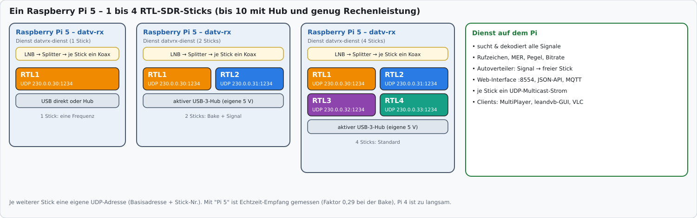
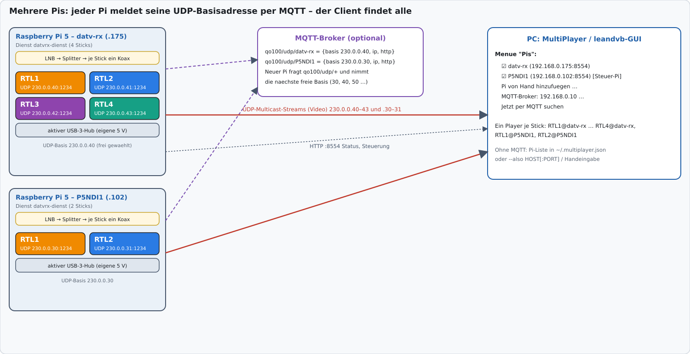

# Raspi5 RTL-SDR Multi Receiver – QO-100 DATV with 1–4 RTL-SDR sticks on a Raspberry Pi 5

**Receive several QO-100 narrowband DATV signals (DVB-S2) at once with 1–4 cheap RTL-SDR sticks (up to 10 with an active USB-3 hub)** on a headless Raspberry Pi 5 and serve them to your home network.
Each stick gets its own UDP multicast video stream; the service finds the signals itself (BATC spectrum), assigns them to free sticks, decodes call sign, MER and level, and watches the beacon.
Watch the streams in VLC, in the **MultiPlayer** (one player per stick) or in the **leandvb-GUI**.

*Deutsch:* Ein Raspberry Pi 5 empfängt mit 1–4 RTL-SDR-Sticks gleichzeitig mehrere QO-100-DATV-Signale und stellt sie im Heimnetz bereit. Ausführliche Anleitung: [`RTL-SDR-datvRX-Dienst/ANLEITUNG.html`](RTL-SDR-datvRX-Dienst/ANLEITUNG.html).



## Features

- Auto scan, auto distribution of new signals to free sticks, beacon offset per stick
- Web interface (`http://<Pi>:8554/`), JSON API (`/api/v1/sticks`), optional MQTT
- UDP multicast stream per stick (`230.0.0.30:1234`, `…31`, …)
- **Several Pis**: each Pi announces its UDP base address via MQTT (`qo100/udp/<host>`) and takes the next free one (30, 40, 50 …); the client finds all of them
- Clients: `multiplayer.py` (Tk, several Pis), leandvb-GUI (sticks as tuners), VLC playlist `/qo100.m3u`
- Without MQTT everything works with config files / manual entry



## Quick start

```bash
# on the PC: install (or update) the service on a Pi (SSH key login, sudo on the Pi)
cd RTL-SDR-datvRX-Dienst
./install_dienst_pi.sh pi@<PI-IP> --lo <LNB LO in MHz> --ppm <correction> --mqtt <broker>   # --mqtt optional
./install_dienst_pi.sh pi@<PI-IP> --enable --start
./install_dienst_pi.sh pi@<PI-IP> --status      # also: --stop, --restart, --entfernen

# on the PC: MultiPlayer (needs python3-tk, vlc/mpv/ffplay)
./multiplayer.py --server <PI-IP>:8554 [--also <PI2-IP>] [--mqtt <broker>]
```

Raspberry Pi 5 (64-bit) is required for real-time decoding (measured factor 0.29 on the beacon; a Pi 4 is too slow).

## Layout

| Path | Content |
|---|---|
| `RTL-SDR-datvRX-Dienst/` | the service (`datvrx_dienst.py`), installer, `dienst.conf.beispiel`, documentation |
| `zapper.py`, `datv_core.py`, `qo100_wacht.py`, … | engine, shared decoding core, beacon/signal watcher |
| `multiplayer.py`, `dienst_client.py` | clients |
| `bilder/` | figures (generated by `gen_installation.py`) |

`datvrx` / `dvbstool` (**DATVision by Daniel HB9IIU**, GPLv3, <https://github.com/HB9IIU/DATVision>) are not my work. Builds for the Raspberry Pi are included in `RTL-SDR-datvRX-Dienst/arm*/` for convenience - source, documentation and current versions are on HB9IIU's page; see `RTL-SDR-datvRX-Dienst/DATVRX-HINWEIS.md` and `arm/BAUEN.html`.

## License

MIT – see [`LICENSE`](LICENSE). `datvrx` (DATVision, HB9IIU) is GPLv3 - see `RTL-SDR-datvRX-Dienst/DATVRX-LICENSE-GPLv3.txt`.

73 de DG7NDV
